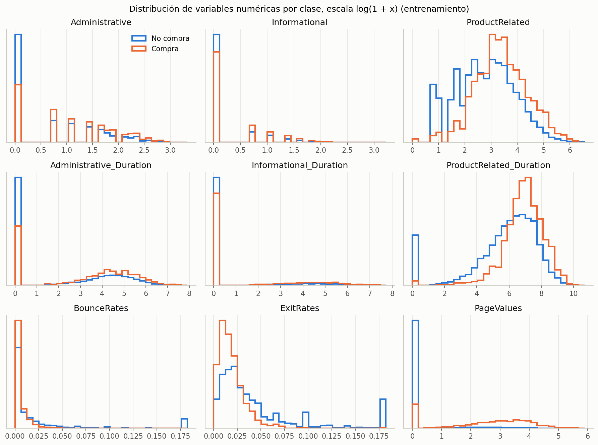
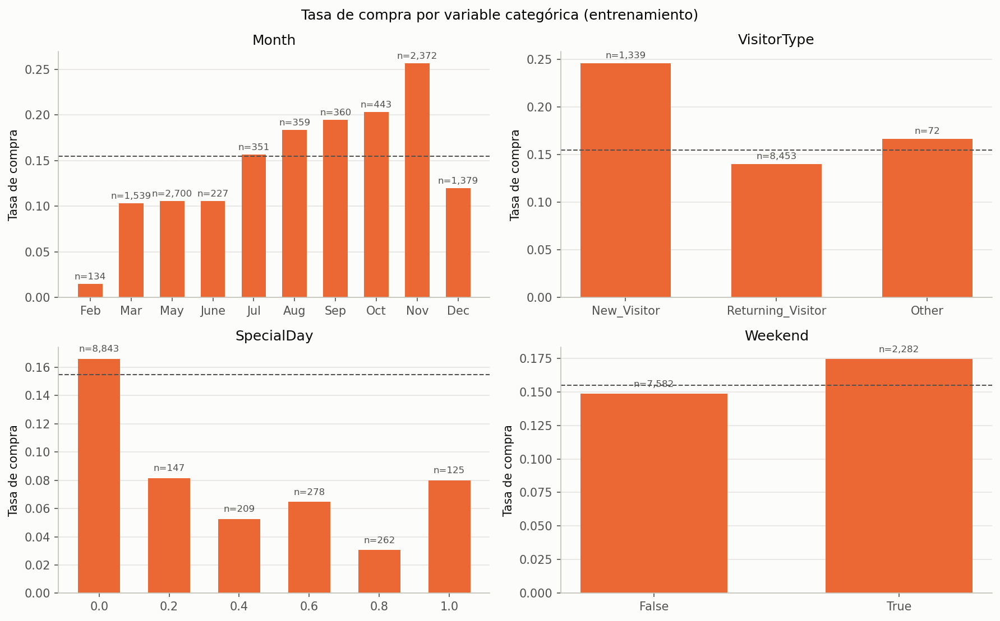
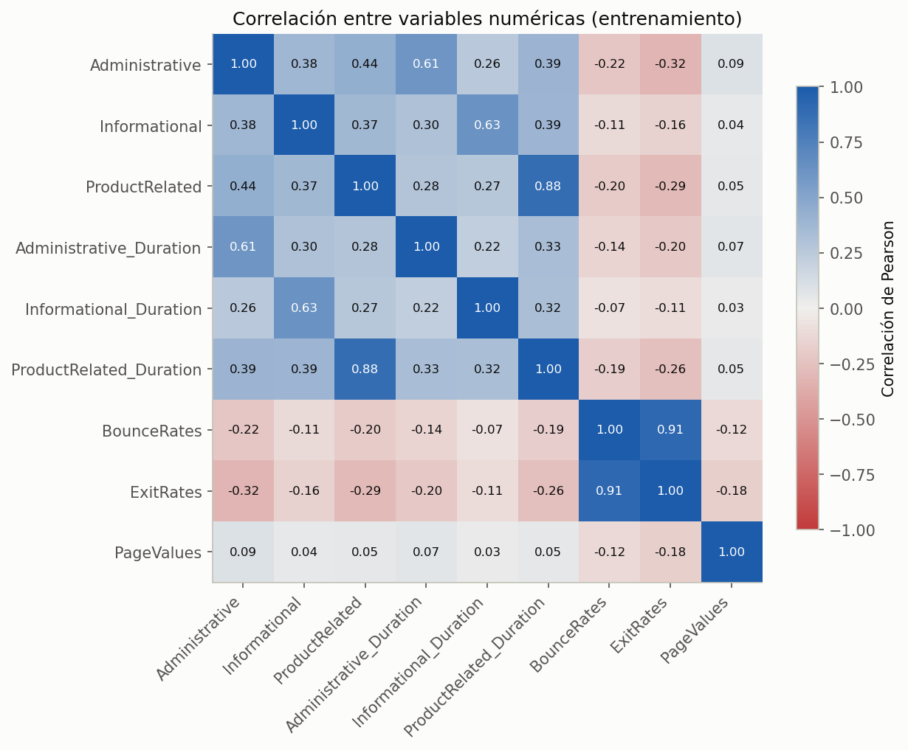

# Reporte de datos

Resultados de la adquisición y exploración de la base Online Shoppers Purchasing Intention. Toda la exploración usa solo el grupo de entrenamiento (9,864 sesiones). Los cálculos están en [`01_data_acquisition.ipynb`](../../Code/Data_Acquisition_and_Understanding/01_data_acquisition.ipynb) y [`02_data_understanding.ipynb`](../../Code/Data_Acquisition_and_Understanding/02_data_understanding.ipynb).

## Resumen general

| Concepto | Valor |
| --- | --- |
| Sesiones | 12,330 |
| Columnas | 18 (17 predictoras y `Revenue`) |
| Entrenamiento | 9,864 sesiones, 1,526 con compra |
| Prueba | 2,466 sesiones, 382 con compra |
| Valores faltantes | Ninguno |

## Calidad de los datos

- **Estructura y rangos.** Las 18 columnas coinciden con la ficha de UCI. Ningún conteo ni duración es negativo, y las tasas y `SpecialDay` están entre 0 y 1.
- **Tasas con tope.** `BounceRates` y `ExitRates` llegan como máximo a 0.20. Es una característica de cómo Google Analytics calcula estas métricas, no un error de captura.
- **Meses faltantes.** Solo hay sesiones de 10 meses; enero y abril no aparecen. El modelo no tiene información de esos dos meses.
- **Formato de mes.** Junio aparece como `June` y los demás meses con tres letras. Se unificó como `Jun`.
- **Tipo de visitante `Other`.** 85 sesiones (72 en entrenamiento) tienen un valor que la ficha no describe. Se conservó como categoría.
- **Filas repetidas.** La base completa tiene 125 copias adicionales (201 filas involucradas), y el grupo de entrenamiento 135 filas involucradas. Todas son visitas de una o dos páginas de productos, con duración cero, rebote máximo y sin compra. Como cada sesión pertenece a un usuario distinto, lo más probable es que sean visitantes diferentes que entraron y salieron de inmediato. Se conservaron, porque eliminarlas haría ver la tienda con menos rebotes de los que tiene.
- **Muchos ceros.** El 78 % de las sesiones tiene `PageValues` igual a cero, el 79 % no visitó páginas informativas y el 47 % no visitó páginas administrativas.
- **Códigos poco frecuentes.** Algunos códigos de `TrafficType`, `Browser` y `OperatingSystems` tienen menos de 30 sesiones; uno de ellos, una sola. En el modelado se agrupan en una categoría común.

## Variable objetivo

Solo el 15.5 % de las sesiones termina en compra. Un modelo que respondiera siempre "no compra" acertaría el 84.5 % de las veces, por lo que la exactitud no sirve para evaluar los modelos. Las métricas del proyecto son el F1 y la sensibilidad de la clase "compra".

## Variables individuales

Todas las variables numéricas tienen una cola larga hacia la derecha: la mayoría de las sesiones tiene valores bajos y unas pocas, muy altos. La asimetría va de 1.95 en `Administrative` a 7.82 en `Informational_Duration`. Para graficarlas se usó la escala `log(1 + x)`.

## Relación con la variable objetivo

### `PageValues`

Es la variable con la diferencia más marcada entre clases.

| Grupo | Sesiones | Tasa de compra |
| --- | --- | --- |
| `PageValues` = 0 | 7,681 | 3.9 % |
| `PageValues` > 0 | 2,183 | 56.2 % |

El 80 % de las sesiones con compra tiene `PageValues` mayor que cero, frente al 11 % de las que no compraron. Como Google Analytics calcula esta variable a partir de las páginas que preceden a una compra, su relación con `Revenue` es muy estrecha. El modelado compara cada modelo con y sin ella.

### Navegación

Quienes compran visitan más páginas de productos (mediana de 28 frente a 16) y pasan más tiempo en ellas (mediana de 1,082 frente a 502 segundos). También tienen tasas de salida más bajas.

### Variables categóricas

- **Mes.** Noviembre tiene la tasa de compra más alta (25.7 %) y febrero la más baja (1.5 %).
- **Tipo de visitante.** Los visitantes nuevos compran más (24.6 %) que los recurrentes (14.0 %).
- **Fin de semana.** La diferencia es pequeña: 17.4 % en fin de semana frente a 14.9 % entre semana.
- **Fecha especial.** Las sesiones cercanas a una fecha especial compran *menos* (entre 3 % y 8 %) que las lejanas (16.6 %). Es contrario a lo esperado, y puede deberse a que los usuarios visitan para comparar opciones antes de la fecha y compran en otro momento.

## Relación entre variables

Dos pares tienen una correlación mayor que 0.7:

| Par de variables | Correlación |
| --- | --- |
| `BounceRates` y `ExitRates` | 0.91 |
| `ProductRelated` y `ProductRelated_Duration` | 0.88 |

Ambos pares se conservaron. Los modelos de árboles toleran variables correlacionadas, y cada una aporta un matiz distinto: el número de páginas no es lo mismo que el tiempo en ellas.

## Decisión de control

Los datos permiten responder la pregunta de negocio: hay diferencias claras entre las sesiones con y sin compra, sobre todo en `PageValues` y en la navegación por productos. El proyecto avanza a la fase de modelado con dos precauciones: comparar los modelos con y sin `PageValues`, y compensar el desbalance de clases.
