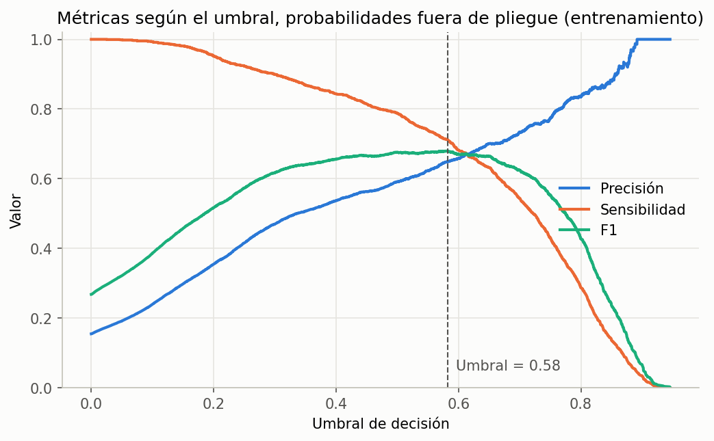
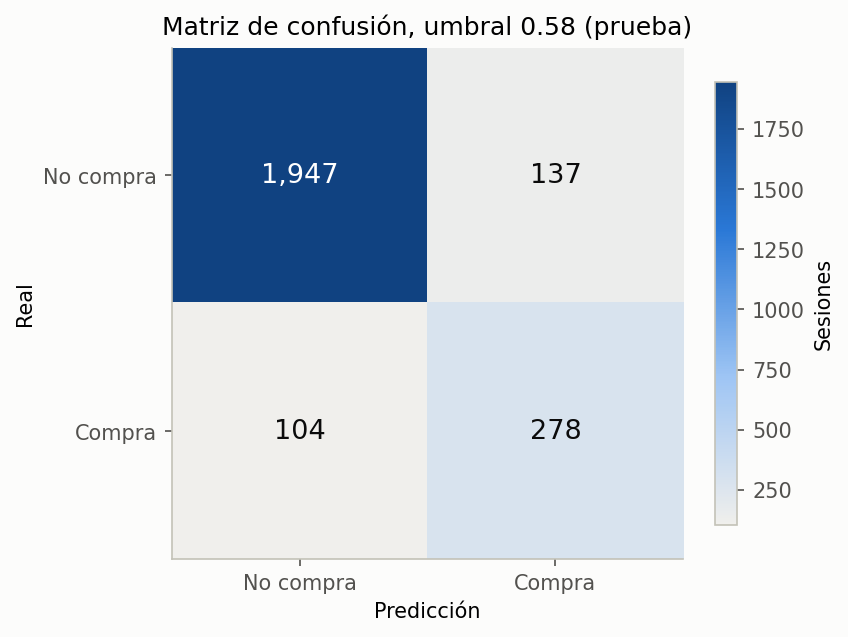
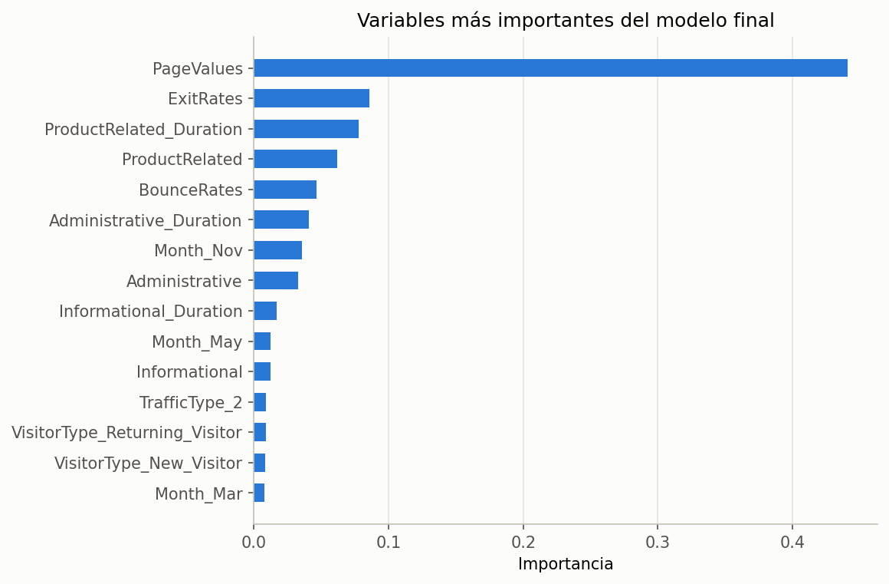

# Reporte del modelo final

Modelo entregado al final del proyecto. La selección, el ajuste del umbral y la evaluación están en [`05_model_evaluation.ipynb`](../../Code/Modeling/05_model_evaluation.ipynb).

## Enfoque

- **Pregunta:** ¿esta visita va a terminar en compra?
- **Variable objetivo:** `Revenue`.
- **Entradas:** las 17 variables de comportamiento de la sesión descritas en el [diccionario de datos](../Data_Dictionaries/Raw-Data-Dictionary.md).
- **Salida:** una probabilidad de compra entre 0 y 1, y la decisión de ofrecer o no el chat proactivo, atendido por un asesor humano.

## Datos

| Concepto | Valor |
| --- | --- |
| Fuente | Online Shoppers Purchasing Intention, UCI Machine Learning Repository |
| Entrenamiento | 9,864 sesiones (1,526 con compra) |
| Prueba | 2,466 sesiones (382 con compra) |
| División | 80/20, estratificada por `Revenue`, `SEED = 1` |

## Algoritmo

**Random Forest con pesos de clase**, el modelo con mayor F1 en validación cruzada (0.671) entre las diez configuraciones evaluadas, sin contar la referencia.

| Parámetro | Valor |
| --- | --- |
| Número de árboles | 300 |
| Profundidad máxima | Sin límite |
| Mínimo de sesiones por hoja | 1 |
| Pesos de clase | `balanced` |
| Umbral de decisión | 0.513 |

El preprocesador y el modelo forman un solo pipeline: las variables numéricas pasan sin cambios y las categóricas se codifican en one-hot.

## Ajuste del umbral

Un modelo de clasificación entrega una probabilidad; el **umbral** decide a partir de qué probabilidad se predice "compra". El umbral se eligió con probabilidades *fuera de pliegue*: cada sesión de entrenamiento recibió una probabilidad de un modelo que no la vio al entrenar. Entre los umbrales con sensibilidad de al menos 0.70, el de mayor F1 fue 0.513. El grupo de prueba no participó en esta elección.

## Resultados en el grupo de prueba

| Modelo | Umbral | F1 | Sensibilidad | Precisión | Precisión promedio | Exactitud |
| --- | --- | --- | --- | --- | --- | --- |
| Referencia | 0.50 | 0.000 | 0.000 | 0.000 | 0.155 | 0.845 |
| Modelo final | 0.50 | 0.694 | 0.741 | 0.652 | 0.759 | 0.899 |
| **Modelo final** | **0.513** | **0.695** | **0.728** | **0.665** | **0.759** | **0.901** |
| Modelo final sin `PageValues` | 0.50 | 0.419 | 0.662 | 0.306 | 0.402 | 0.715 |

De las 382 sesiones con compra, el modelo detectó 278 y dejó pasar 104. De las 418 alertas que generó, 140 correspondieron a visitantes que no compraron.

El F1 en prueba (0.695) es incluso un poco mayor que en validación cruzada (0.671), así que no hay señales de sobreajuste. El ajuste del umbral apenas cambia el resultado frente al umbral estándar, lo que indica que los pesos de clase ya habían compensado bien el desbalance.

## Importancia de las variables

`PageValues` concentra el 35 % de la importancia total del modelo, cuatro veces más que la siguiente variable (`ExitRates`, 9 %). Le siguen las variables de navegación por productos. El mes de noviembre es la variable categórica más útil, en línea con su tasa de compra elevada.

Esta importancia se calcula a partir de cuánto mejora cada variable las divisiones de los árboles. Es una medida rápida, pero tiende a favorecer variables con muchos valores distintos, por lo que sirve como orientación y no como una medida exacta.

## Conclusiones

- **El modelo cumple las metas del acta**: F1 de 0.695 (meta 0.60) y sensibilidad de 0.728 (meta 0.70) en el grupo de prueba.
- **La dependencia de `PageValues` es el principal riesgo.** Sin ella, el F1 cae a 0.419. Una tienda nueva necesita tener Google Analytics configurado con el valor de sus transacciones para que esta variable exista, y su valor depende de los precios y productos de cada tienda.
- **Posibles mejoras:** variables derivadas, como el tiempo promedio por página de producto; probar modelos de *gradient boosting*; y, sobre todo, reentrenar con datos propios de la tienda, incluidas sesiones registradas a mitad de la visita.
